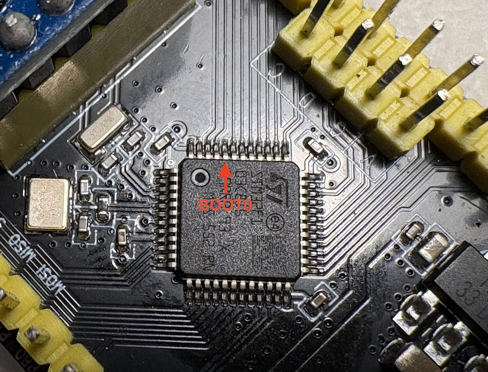

# SPECTER Native MeshCore Repeater for DX-LR30

> The DX-LR30 is a cheap Chinese LoRa shell device. MeshCore has no official
> firmware for STM32F103 + SX1262.
> Specter is a very energy efficient LoRa Meshcore repeater, consuming 0.5-150 mA (RX average is 30 mA).
> It can be configured over USB using https://config.meshcore.io/ or using the Remote Management
> The Meshcore CLI protocol over TTY is also supported

---

## Getting started
There are two major options to go:

### Flash the latest pre-built firmware and configure it over USB CLI
Note: Remote management over mesh is disabled by default

### Put your meshcore parameters into platformio.ini and build your pre-configured BIN
Follow **configure** steps before building

## Building

### Prerequisites
PlatformIO or pioarduino. Optionally, use Visual Studio Code with corresponding plug-ins

```bash
pip install platformio
# or: brew install platformio
```

### Build the default firmware (specter)

```bash
cd meshcore-specter-dx-lr30
pio run -e specter
# Output: .pio/build/specter/firmware.bin  (~75KB)
```

### Build pre-configured firmware (specter_custom)
```bash
cd meshcore-specter-dx-lr30
pio run -e specter_custom
# Output: .pio/build/specter_custom/firmware.bin  (~75KB)
```

---

## Flashing

That's a very tricky part. The board wasn't designed to be flashed over USB, but it's possible.

### With ST-Link V2
For buttonless/headless flashing use the board's **SWD header** with an
[ST-Link V2](#headless-flashing-swd-recommended). The most robust way, always works.
(PlatformIO: set upload_protocol = stlink, upload_port = /dev/stlink.)
```bash
pio run -e specter -t upload
```
or
```bash
st-flash write .pio/build/specter/firmware.bin 0x08000000
```

### Over USB, if you're lucky
Your goal is to put the board in bootloader/DFU mode by playing with 2 physical buttons (RST, KEY).
In bootloader mode, the blue LED is OFF and not blinking, firmware upload commands don't fail 

For the vanila DX-LR30 the following will most likely work:
- Press and hold KEY
- Short press RST
- Release KEY

If your board already runs older version of Specter and you want to upload a newer one:
Try pressing RST, KEY (like for vanila), touching MCU pins, unplug/plug USB until you enter bootloader mode (blue LED isn't flashing).
It might take several minutes and a hundred of attempts, but eventually you'll be there.

### Over USB, if you have soldering skills
BOOT0, which needs to be pulled to 3.3v for bootloader mode is not connected on this board

Solder a thin wire there, and connect it to 3V3, press RST, disconnect -> you're in bootloader

Once your board in bootloader mode, either upload commands will work:
```bash
pio run -e specter -t upload
```
Or
```bash
stm32flash \
  -w .pio/build/specter/firmware.bin \
  -v -R /dev/ttyUSB0   (or /dev/cu.usbserial-10 on macOS)
```

---
## Configure your Repeater
### Config over USB
- Connect DX-LR30 to your computer over USB
- Open https://config.meshcore.io in Google Chrome
- Click "Connect" and pick the serial port (ttyUSBxx or cu.usbserial-xxx)
- Fill the values and click "Save settings"
- Optionally setup Admin password for remote management over the mesh

### Pre-configure custom firmware (before flashing)
Edit `platformio.ini` by changing `build_flags` values of `specter_custom` environment:
| FLAG NAME | Purpose | Example |
|-----------|---------|---------|
| NODE_NAME_STR | public node name | -D NODE_NAME_STR=\"DE.BY.SPECTER-007\" |
| NODE_LAT_I | latitude  × 1 000 000 | -D NODE_LAT_I==51478700 |
| NODE_LON_I | longitude × 1 000 000 | -D NODE_LON_I=-3186700 |
| ADMIN_PASSWORD | remote management | -D ADMIN_PASSWORD=\"secret\" |
| FIXED_PRIVKEY_HEX | override autogenerated PK | use gen_identity.py | 

#### GPS coordinates
```
latitude  =  51.4787° N  →  NODE_LAT_I=51478700
longitude =  -3.1867° W  →  NODE_LON_I=-3186700
```

Currently, frequency/region configs are not exposed as build flags. 
They're defined in `config.h` using the "EU/Narrow preset", you can change the configuration there.


### Use the official Meshcore app
Using your companion node paired with Meshcore app you can use the "Remote Management".
Most of the features are supported, as well as Guest access.

### CLI quick tour
You can use CLI in https://config.meshcore.io or use the serial monitor:
```bash
pio run -e specter -t monitor
```

Type commands directly (Enter after each). Full reference:
[docs/cli.md](docs/cli.md#3-using-the-cli-operating-guide).

```
ver                          → 1.4.0 (Oct 26 2026)
get name                     → SPECTER.REPEATER
set name DE.BW.Specter-01    → OK
get lat / set lat 52.52      → 52.520000 / OK
get radio                    → 869.618,62.5,8,8
set radio 869.525,62.5,8,5   → OK, reboot to apply
get flood.advert.interval    → 17            (hours, 3-168, EU default 47)
set advert.interval 120      → OK            (zero-hop minutes, 60-240, 0=off)
neighbors                    → F7A9:1793148995:45
stats-packets                → rx=7 relay=4 drop=3 advert=1
log / log erase              → last 20 diagnostic lines / empty buffer
clock / time 1793052700      → re-sync advert clock
advert / advert.zerohop      → trigger an ADVERT now
reboot                       → (no reply, per spec)
erase                        → factory reset (wipes stored settings)
```

All `set` commands persist to a dedicated flash page and survive power
cycles. `erase` restores build-flag defaults. `set radio`/`set freq`/`set tx`
require a `reboot` to take effect.

## Identity

SPECTER derives each node's identity from the **STM32 unique device ID**
(96-bit UID at `0x1FFFF7E8`). This guarantees a stable, unique identity
without EEPROM or external storage. See also tools/gen_identity.py

---
## Hardware


WARNING: Radio-module inserted wrong way here!

| Component | Part | Notes |
|-----------|------|-------|
| MCU | STM32F103C8T6 LQFP48 | 72 MHz Cortex-M3, 128KB Flash, 20KB RAM |
| Radio | SX1262 | Sub-GHz LoRa, up to +22 dBm |
| USB-Serial | CH340 (CH340C) | DTR/RTS entry not wired -> No software DFU |
| SWD header | V G D C = 3V3/GND/SWDIO (PA13)/SWCLK (PA14) | Headless flashing with an ST-Link V2 |
| LED | PB11 | Active HIGH — 1 blink = RX · 2 fast blinks = relay · solid = ADVERT TX |

BOOT0 pin is disconnected. It captures random voltages, therefore it's sometimes possible
to enter the bootloader mode just by pressing the RST

## Documentation (TODO: deslop)

- [docs/cli.md](docs/cli.md), CLI command reference + operating guide
- [docs/hardware.md](docs/hardware.md), Pin assignments, bootloader specs, UID
- [docs/protocol.md](docs/protocol.md), MeshCore packet format, Ed25519 signing
- [docs/development-notes.md](docs/development-notes.md), Lessons learned


## License

MIT License, see LICENSE file for details.

---

