# Development Notes & Lessons Learned

This document captures critical insights discovered during SPECTER development
that are not obvious from datasheets or library documentation.

---

## STM32 Bootloader Baud Rate

The DX-LR30's STM32F103 ROM bootloader listens at **115200 8E1** (8 data
bits, even parity, 1 stop bit). Use `-b 115200` with stm32flash:

```bash
stm32flash -b 115200 -w firmware.bin -v -R /dev/ttyUSB0
```

### Verification

```bash
# Probe bootloader (with BOOT0 held, after RESET):
stm32flash -b 115200 /dev/ttyUSB0 2>&1

# Expected output:
# Version      : 0x22
# Device ID    : 0x0410 (STM32F10xxx Medium-density)
```

---

## Ed25519 Signature Requirement

**MeshCore companions validate ADVERT signatures.** Unsigned or incorrectly
signed ADVERTs are silently discarded.

### The Problem

Initial SPECTER implementations sent ADVERTs with 64 zero bytes in the
signature field. The Heltec V3 companion running MeshCore v1.15.0 would:

1. Receive the ADVERT packet (confirmed via packet capture)
2. Parse the header and payload
3. Validate the Ed25519 signature over `pubkey + timestamp + appdata`
4. **Silently drop** the packet because signature = all zeros

Result: The repeater never appeared in the MeshCore app, showing **"0 repeaters"**.

### The Solution

Use **rweather/Crypto** library to generate valid Ed25519 signatures:

```cpp
#include <Ed25519.h>
#include <SHA256.h>

// Derive deterministic private key from STM32 UID:
void identity_init(void) {
    const uint32_t uid[3] = {
        *(volatile uint32_t*)0x1FFFF7E8U,
        *(volatile uint32_t*)0x1FFFF7ECU,
        *(volatile uint32_t*)0x1FFFF7F0U,
    };

    // Hash (domain_string + UID) → 32-byte private key
    SHA256 sha;
    sha.reset();
    sha.update((uint8_t*)"SPECTER-MESHCORE-KEY-V1", 23);
    sha.update((uint8_t*)uid, 12);
    sha.finalize(own_privkey, 32);

    // Derive public key
    Ed25519::derivePublicKey(own_pubkey, own_privkey);
    own_hash = own_pubkey[0];  // 1-byte path hash for routing
}

// Sign ADVERT:
void build_advert(uint8_t *pkt, uint8_t *len) {
    uint8_t *sig_start = pkt + 2 + 32 + 4;  // after pubkey + timestamp
    uint8_t *appdata   = pkt + 2 + 32 + 4 + 64;
    uint8_t appdata_len = /* flags + name */;

    // Sign: pubkey || timestamp || appdata
    Ed25519::sign(
        sig_start,
        own_privkey,
        own_pubkey,
        pkt + 2,  // pubkey start
        32 + 4 + appdata_len
    );
}
```

### Verification

After implementing Ed25519:
- The Heltec companion immediately saw the node
- MeshCore app showed **"SPECTER-1811"** as an active repeater
- Relay packets were accepted and forwarded

### Key Derivation Rationale

Using `SHA256(domain + UID)` ensures:
1. **Deterministic**: Same key on every boot (no EEPROM needed)
2. **Unique**: Each STM32 chip has a factory-unique 96-bit UID
3. **Irreversible**: Cannot recover UID from public key
4. **Domain-separated**: Collision-resistant against other uses of the UID

---

## Mesh Administration Protocol

SPECTER speaks the official MeshCore **peer-data** protocol so an official
companion radio can log in and run CLI commands over the LoRa mesh. This is the
reference for byte-exactness — the companion firmware is the ground truth.

### Crypto (verified byte-exact, `src/meshcrypto/`)

- **Shared secret** = `X25519(their_key, our_pub)`, ported verbatim from
  `MeshCore/lib/ed25519/key_exchange.c` + `fe.c`. It X25519-clamps the *scalar*
  and unpacks the *Ed25519 public key* (Edwards Y → Montgomery X via
  `(Y+1)/(1-Y)`).
- **CRITICAL — the scalar is `SHA512(seed)[0:32]` clamped, NOT the raw seed.**
  The official `create_keypair()` does `private_key = SHA512(seed)`, clamps it,
  and *that* is what `calcSharedSecret()` passes to `key_exchange()`. SPECTER's
  `own_privkey` is a raw seed (used by the Crypto lib for the ADVERT signature),
  so we derive a separate `own_x25519_key = SHA512(own_privkey)[0:32]` clamped
  and pass *that* to the exchange. Passing the raw seed would never agree with a
  real companion. (The Crypto lib's `deriveKeys` is byte-identical to this:
  `buf[0]&=0xF8; buf[31]&=0x7F; buf[31]|=0x40`.)
- **Cipher** = AES-128-ECB, no IV, final block zero-padded. AES key = first 16
  bytes of the 32-byte secret.
- **MAC** = first 2 bytes of `HMAC-SHA256(key=secret, msg=ciphertext)`,
  **prepended** to the ciphertext. Decrypt verifies the MAC first (reject on
  mismatch) — so a tampered packet is dropped, not decrypted.

### Wire layout

| Packet | payload (after path) |
|---|---|
| **ANON_REQ** (0x07) | `dest_hash(1) sender_pub(32) [MAC(2)+AES( ts(4) \| password )]` |
| **TXT_MSG** (0x02) | `dest_hash(1) src_hash(1) [MAC(2)+AES( ts(4) flags(1) text )]` where `flags = byte>>2`; `3`=CLI_COMMAND, `1`=CLI_DATA |
| **RESPONSE** (0x01) | `dest_hash(1) src_hash(1) [MAC(2)+AES( ts(4) 0x00 0x00 is_admin(1) perms(1) rand(4) ver_level(1) )]` |

- `dest_hash`/`src_hash` are 1-byte path hashes = `pubkey[0]`.
- A companion sends **ANON_REQ as a flood** (it doesn't know our path yet);
  SPECTER replies with a **flood RESPONSE** (the client learns our hash). All
  admin packets are *flooded* — confidentiality comes from the per-session
  encryption, not routing.

### Sessions (`src/acl.cpp`)

- In-memory, 4 slots, keyed by the client's **ephemeral** pubkey (each login =
  a fresh ephemeral key = a fresh session). Not persisted; a reboot ends all.
- Stores: pubkey, per-session shared secret, permission, `last_ts` (replay
  guard — a re-login must carry a greater timestamp), `last_activity_ms` (idle
  timeout, expired in `loop()` after `admin.timeout` seconds).
- Match on TXT_MSG is by `src_hash` (1 byte) → `acl_by_hash()`.

### Permission gate (`cmd_perm_needed()`)

- READ: `get` `ver` `board` `role` `clock` `time` `stats-*` `neighbors` `log` `acl`
- READWRITE: `set`
- ADMIN (and anything unlisted, fail-safe): `reboot` `erase` `dfu`, …
- Admin password → ADMIN, guest password → READ.

### Test

`/tmp/login_test.cpp` (host) builds each packet exactly per the layout above
and runs the server-side parse. It also checks the client/server X25519 secrets
agree, the MAC rejects tampering, and a wrong scalar is rejected. Build it with
the Crypto lib sources + `src/meshcrypto/*` (see the recipe in the commit).

---

## Radio Configuration Mismatch Symptoms

### The Problem

Default MeshCore examples often show:
```cpp
#define LORA_FREQ 869.525f  // EU868 default
```

But a **custom-configured companion** may use:
```cpp
#define LORA_FREQ 869.618f  // User-configured channel
```

If the repeater uses 869.525 and the companion uses 869.618, they will **never
hear each other**, even at close range.

### Diagnosis

```mermaid
flowchart LR
    classDef ok fill:#163316,stroke:#5cb85c,color:#e8f5e9
    classDef bad fill:#3a1a1a,stroke:#d9534f,color:#fde8e8

    R["Repeater\n869.525 MHz\nSF8 BW62.5"]:::bad
    C["Companion\n869.618 MHz\nSF8 BW62.5"]:::bad
    R -.X 93 kHz offset X.-> C

    style R fill:#3a1a1a,stroke:#d9534f
    style C fill:#3a1a1a,stroke:#d9534f
```



93 kHz offset is **far outside** the 62.5 kHz receive bandwidth. No packets
are exchanged.

### Solution

**Match all parameters exactly**:

| Parameter | Must Match |
|-----------|------------|
| Frequency | ±5 kHz max (practically: exact) |
| Spreading Factor | Exact |
| Bandwidth | Exact |
| Coding Rate | Exact |
| Sync Word | Exact |
| CRC | Both enabled or both disabled |

Use a spectrum analyzer or confirm via serial log from companion if possible.

---

## Serial Monitor Boot Message Capture

### The Problem

The STM32 firmware prints its boot banner immediately after reset:

```
T=0ms: === SPECTER MeshCore Repeater [SPECTER-1811] ===
T=5ms: Hash: 0xF4
T=8ms: Radio init... OK
```

If you start the serial monitor **after** the device boots, you miss these
messages.

### Solution

**Start monitoring before pressing RESET**:

```bash
# Terminal 1: Start monitor
python3 -c "
import serial, time, sys
s = serial.Serial('/dev/ttyUSB0', 115200, timeout=0.1)
print('=== Monitoring, press RESET now ===')
t_end = time.time() + 20
while time.time() < t_end:
    line = s.readline()
    if line:
        print(line.decode(errors='replace').rstrip())
        sys.stdout.flush()
s.close()
"

# While monitor is running, press physical RESET button (not BOOT0)
```

The RESET button triggers a clean boot without entering bootloader mode.

---

## Independent Watchdog (IWDG)

The firmware enables the STM32F103 **Independent Watchdog (IWDG)** with an
8-second timeout. The IWDG runs from the internal 40 kHz LSI oscillator,
completely independent of the main CPU clock and system reset logic.

### Behaviour

| State | IWDG outcome |
|-------|--------------|
| Normal operation | `IWatchdog.reload()` is called at the top of every `loop()` iteration — watchdog never fires |
| Radio HALT (SX1262 init failure) | Firmware enters 5 Hz LED blink loop — no reload — IWDG fires after 8 s — chip resets — retries `radio_init()` |
| Main loop freeze (any other cause) | Same as above — watchdog fires, chip resets |

### Why 8 seconds?

Maximum single-pass blocking time in `loop()` is ≈ 800 ms (CSMA backoff) +
≈ 500 ms (TX airtime) ≈ 1.3 s total. 8 s gives a comfortable 6× margin
while still recovering promptly from a stuck state.

### Initialisation

```cpp
// In setup(), before radio_init():
IWatchdog.begin(8000000);  // 8 000 000 µs = 8 s

// In loop(), first line:
IWatchdog.reload();
```

The watchdog is started **before** `radio_init()` so a failure there is also
covered. `IWatchdog.h` is a STM32duino built-in — no extra `lib_deps` entry
needed beyond `platform = ststm32` with `framework = arduino`.

### Before vs after IWDG

| | Before IWDG | After IWDG |
|---|---|---|
| SX1262 SPI glitch on power cycle | Board blinks at 5 Hz indefinitely, requires physical RESET | Board blinks ≤ 8 s, resets, retries automatically |
| Any `while(true)` hang in firmware | Permanent lock-up | Auto-reset in ≤ 8 s |

---

## LED Behaviour Patterns

The onboard LED is on **PB11, active HIGH** (HIGH = ON, LOW = OFF).

| Pattern | Trigger |
|---------|---------|
| Solid ON (boot) | `setup()` running — identity init + radio init in progress |
| OFF (idle) | Radio initialised, listening for packets |
| 1 × 80 ms blink | Heartbeat every 10 s (sign of life) |
| 1 × 40 ms blink | LoRa packet received (any route type) |
| 2 × 30 ms fast blinks | Packet successfully processed and relayed (connectivity confirmed) |
| Solid ON (variable ~300–800 ms) | ADVERT transmitting — CSMA backoff + TX airtime |
| 5 Hz continuous blink | Radio init HALT — IWDG will reset the board in ≤ 8 s |

### Implementation

```cpp
// Helper in main.cpp:
static void led_blink(uint8_t n, uint16_t ms) {
    for (uint8_t i = 0; i < n; i++) {
        digitalWrite(PIN_LED, LOW);   // ON
        delay(ms);
        digitalWrite(PIN_LED, HIGH);  // OFF
        if (i < n - 1) delay(ms);
    }
}

// Usage:
led_blink(1, 40);   // on RX (packet received)
led_blink(2, 30);   // on relay TX (connectivity)
// Solid ON/OFF around send_pkt() for ADVERT transmissions
```

---

## Common Pitfalls

### 1. Wrong USB Port

DX-LR30 on `/dev/ttyUSB0`, Heltec on `/dev/ttyUSB1`. Swapping ports causes:
- `stm32flash` to fail (tries to flash Heltec)
- Serial monitor showing wrong device output

**Fix:** Always verify with `ls -la /dev/ttyUSB*` and note which was plugged
in first.

### 2. Forgetting BOOT0 Sequence

If you run `stm32flash` without entering bootloader mode:
```
Failed to init device.
```

**Fix:** Hold BOOT0, pulse RESET, release BOOT0 **before** running stm32flash.

### 3. Heltec Companion Has No Serial CLI

The Heltec V3 running MeshCore v1.15.0 BLE only exposes:
- BLE interface for the MeshCore app
- **No serial commands** (unlike some other firmware)

Sending AT commands or debug commands to `/dev/ttyUSB1` does nothing.

**Fix:** All Heltec interaction must be via the MeshCore Android/iOS app over BLE.

### 4. Caching in MeshCore App

When testing name changes (e.g., SPECTER-1811 → SPECTER-7419 → SPECTER-1811),
the app may cache the node by public key and not immediately reflect the new name.

**Fix:** The public key is tied to the UID, so it never changes for a given
chip. The name change should eventually propagate, but expect delays. Restarting
the app or clearing app data may help.

---

## Memory Constraints

### Flash

The STM32F103C8T6 is sold as **64KB flash**, but many clones have **128KB**
unlocked. SPECTER uses:

```
Flash: [====      ]  39.5%  (51752 / 131072 bytes)
```

If your chip is genuine 64KB:
```
Flash: [========  ]  79.1%  (51752 / 65536 bytes)
```

Still fits comfortably. To optimize further:
- Remove debug `Serial1.print()` statements
- Use `-Os` instead of `-O2` in `platformio.ini`

### RAM

```
RAM:   [==        ]  15.3%  (3128 / 20480 bytes)
```

Plenty of headroom. The dedup cache (64 × 6 bytes = 384 bytes) and packet
buffers are the largest allocations.

---

## Testing Strategy

### Minimal Test (No Companion)

Flash SPECTER, open serial monitor, press RESET:

```
=== SPECTER MeshCore Repeater [SPECTER-XXXX] ===
Hash: 0xXX
Radio init... OK
Sending initial ADVERT...
Listening...
ALIVE uptime=10s
Listening...
ALIVE uptime=20s
```

✅ If you see periodic "ALIVE" + "Listening...", radio init succeeded.

### With Companion

1. Power on Heltec V3 (with MeshCore BLE firmware)
2. Open MeshCore app, connect via BLE
3. Flash SPECTER, wait 5 seconds (first ADVERT)
4. Check app: should show **"SPECTER-XXXX"** in repeaters list

✅ If repeater appears, Ed25519 + radio config are correct.

### Relay Test

Send a message from another MeshCore node. SPECTER serial should show:

```
B RSSI=-87 SNR=7 len=110
Relay hop=2
```

✅ "Relay hop=X" means the packet was successfully relayed.

---

## Future Improvements

### Possible Enhancements

1. **Packet statistics**: Count RX/TX/relay/drop per category
2. **Remote config**: Listen for config packets to change TX power, name, etc.
3. **Persistent dedup**: Store cache in simulated EEPROM across reboots
4. **OLED display**: Show node name, uptime, last RSSI (would require I2C pins)
5. **GPS support**: Add GPS module for APRS-style position ADVERTs
6. **Multi-channel**: Listen on multiple frequencies (requires time-slicing RX)

### Known Limitations

1. **No DIO1 interrupt**: Polling mode only, ~1ms latency per check
2. **Duty cycle = token bucket** (not the official's full non-blocking scheduler): the
   budget is consumed/refilled in `send_pkt()` and a deficit blocks (in ≤500 ms
   slices, watchdog + CLI kept alive) rather than deferring the TX via a
   `next_tx_time` timestamp. Equivalent average-airtime behaviour; slightly
   coarser timing.
3. **No LBT (Listen Before Talk)**: Simple random backoff, not carrier sense
4. **No encryption**: Packets are plaintext (MeshCore design choice)

---

## RF Duty Cycle: Token Bucket (v1.14.0)

EU 868 MHz duty-cycle compliance is a **token bucket**, matching the official
`Dispatcher` (not a fixed per-packet silence):

- **Window:** 1 hour (`DUTY_WINDOW_MS = 3 600 000 ms`).
- **Bucket size (max budget):** `window × duty`, where `duty = dutycycle/100`.
  At the 10 % default that is 360 000 ms (6 min) of airtime.
- **Refill:** continuously at the duty rate — `budget += elapsed × dutycycle/100`,
  capped at the max. So idle time tops the bucket back up.
- **Consume:** each TX subtracts its *measured* on-air time (from a `millis()`
  around `radio.transmit()`), clamped at 0.
- **Gate:** before a TX, if the budget is below the estimated airtime, wait for
  the deficit to refill (`wait = deficit × 100 / dutycycle`, in ≤500 ms slices).
  Capped at `DUTY_SILENCE_MAX_MS` (30 s) as a safety.
- **Boot:** the bucket starts **full**, so a freshly booted node can burst before
  it's throttled — same as the official.
- **Visibility:** `stats-core` reports `budget=<ms>` (the remaining budget).

All math is integer fixed-point with 64-bit intermediates (no float), so it's
newlib-nano safe. `dutycycle` 0 or ≥100 disables enforcement.

## newlib-nano Float printf Is a Silent No-op

### The Problem

`snprintf(buf, n, "%.6f", x)` on the ststm32/newlib-nano toolchain compiles
fine but prints **nothing** — no warning, no crash, just a truncated/empty
string. Every CLI command that formatted a float (`get lat`, `get radio`,
`get txdelay`) returned an empty line on hardware while looking correct in
code review. `get radio` returned `,,8,8` (both floats silently dropped).

### The Solution

Do all decimal output and parsing in **integer fixed point**:

```c
// format: micro-degrees → "52.520007"
static void print_fixed(int32_t x, int decimals) {
    bool neg = x < 0;
    uint32_t v = neg ? (uint32_t)(-x) : (uint32_t)x;
    uint32_t scale = 1;
    for (int i = 0; i < decimals; i++) scale *= 10;
    if (neg) Serial1.print('-');
    Serial1.print(v / scale);
    Serial1.print('.');
    uint32_t frac = v % scale;
    for (uint32_t m = scale / 10; m > 0; m /= 10)
        Serial1.print((frac / m) % 10);
    Serial1.println();
}
```

(Alternative: enable float printf via a nano.specs file, but that costs
~14 KB of flash — SPECTER's CLI avoids it entirely.)

### Verification

- `get lat` → `52.520007` · `get radio` → `869.618,62.5,8,8` ✓
- Firmware shrank 75 KB → 61 KB after removing float printf support

---

## USB Serial Port Contention (PommeCore)

The MeshCore companion app **PommeCore holds /dev/cu.usbserial-10 open**
and consumes all serial traffic. Symptoms: CLI test scripts receive nothing
(or intermittent EIO "readiness but no data" errors from the CH340 driver),
while the device LED shows normal operation.

```bash
lsof /dev/cu.usbserial-10   # → quit the listed app before CLI work
```

---

## config.meshcore.io USB Compatibility (v1.14.0)

The official **config.meshcore.io** web client (the one the MeshCore FAQ
points you to for USB repeater config) speaks plain text, but its parser
(`lib/serial-cli.js`) requires **three** byte-exact things. Missing any of
them makes a command silently time out (5 s) or a variable "unsupported":

1. **Reply marker** `  -> ` — parser does `readBuffer.indexOf("  -> ")`.
2. **CRLF** line ends — parser does `indexOf('\r\n', payloadStart)`.
3. **`> ` value prefix on `get` replies** — `parseVariableResponse()` does
   `response.startsWith("> ")` then `substring(2)`. The official firmware
   formats every `get` reply as `"> <value>"`, so the full line is
   `  -> > <value>\r\n`.

The third is the subtle one: without it, every `get` parses to null, the app
marks the variable unsupported, and `setData()` skips it — so the UI shows
"saved" but the device kept its old values. SPECTER emits `get` replies via
`getv()`/`getv_num()` (`  -> > <value>\r\n`). The app's airtime slider uses
variable `af` (`duty% = 100/(af+1)`), bridged to our `dutycycle`. Version
`1.14.0` is what the app's `varMinVersion` feature-detection needs to expose
`loop.detect` (the version number drives *only* `supportsVar`).

> The phone apps (PommeCore / meshcore.js / **app.meshcore.nz**) are
> **companion** clients (framed `0x3C/0x3E` + login) and cannot administer a
> repeater over USB — that's by design, not a bug. Use config.meshcore.io.

---

## Radio-Init Failure Must Not Halt (v1.14.0)

**Problem:** the old `setup()` did `while(true){ blink }` when
`radio_init()` failed. A single bad setting (or a transient RF fault) then
**bricked the serial CLI** — no `erase`, no `set`, no recovery except a
reflash. This actually happened: a `set radio` with an invalid bandwidth made
the device boot into a blink loop that would not answer the CLI.

**Fix:** on failure, set `radio_ok = false` and enter **degraded mode**.
`loop()` keeps calling `cli_poll()` (serial is never bricked) and retries
`radio_init()` every 3 s (triple-blink LED while down). Correct the setting
over serial and the radio recovers on the next retry — no reflash, no reboot
required. Solid-on LED = radio not ready; off = ready.

---

## `set radio` Bandwidth Validation Was Broken (v1.14.0)

`parse_radio()` validated bandwidth as `7000000–50000000` (micro-kHz) =
**7–50 kHz**, so every *real* LoRa bandwidth (62.5/125/250/500 kHz) was
rejected while invalid ones slipped through. Corrected to `7.8–500 kHz`
(SX1262 range), and frequency to the SX1262's `150–960 MHz`. Ranges are now
freq 150–960 MHz, BW 7.8–500 kHz, SF 5–12, CR 5–8.

---

## Conclusion

The DX-LR30 is a **capable and cheap** MeshCore repeater when the following
are addressed:

- ✅ Use **115200 8E1** for stm32flash
- ✅ Implement **real Ed25519 signing** (rweather/Crypto)
- ✅ Match **all radio parameters** exactly to your network

With these fixes, SPECTER provides a fully autonomous, sub-$10 flood repeater
node that interoperates seamlessly with official MeshCore devices.
