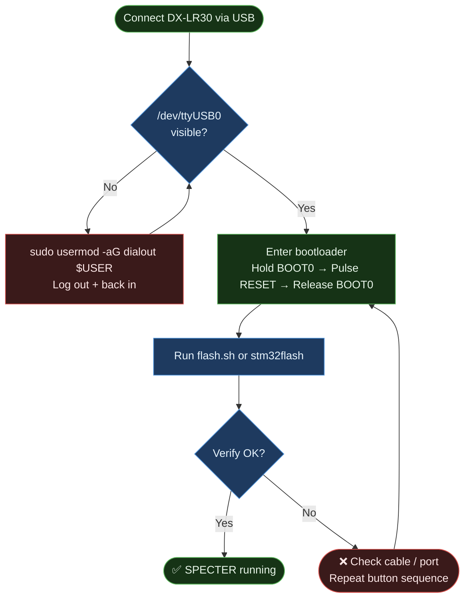
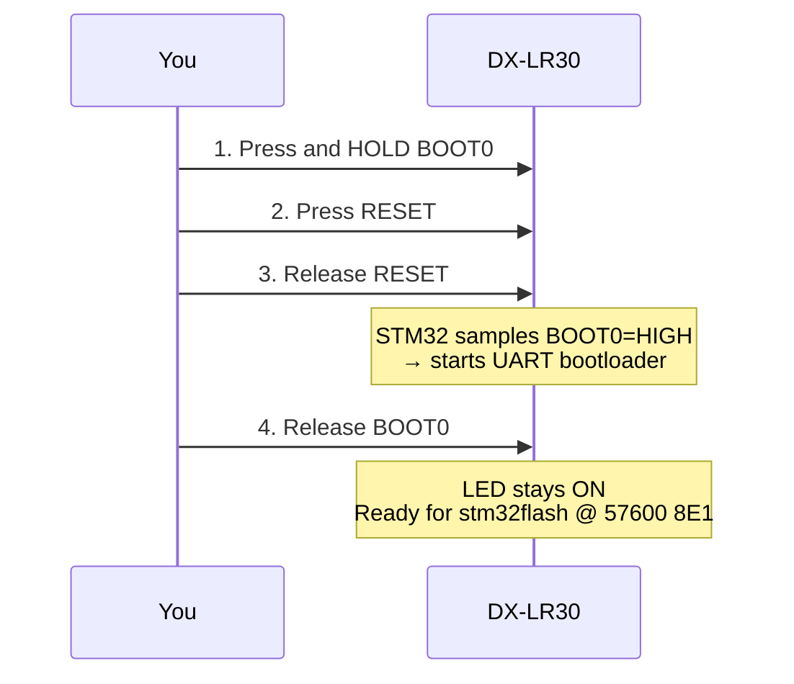

# Flashing Guide, SPECTER on DX-LR30

## Overview

The DX-LR30 uses an **STM32F103C8T6** with a factory UART bootloader
accessible via the BOOT0 pin. Bootloader entry over USB (DTR/RTS) is
**not possible** on this board — see
[Programmatic bootloader entry over USB: NOT possible](#programmatic-bootloader-entry-over-usb-not-possible).
Entry is via the **physical buttons** (UART flashing) or, for fully
headless operation, via the **SWD header** with an ST-Link V2 — see
[Headless flashing: SWD](#headless-flashing-swd-recommended).



---

## Prerequisites

### Software

```bash
# PlatformIO (for building)
pip install platformio

# stm32flash (for flashing)
sudo apt install stm32flash       # Debian/Ubuntu
# or: brew install stm32flash     # macOS
# or: /usr/bin/stm32flash        # may already be present
```

### Permissions

```bash
# Check if your user is in dialout
groups | grep dialout

# If not:
sudo usermod -aG dialout $USER
# Log out and back in, then reconnect the device
```

### Verify device is visible

```bash
ls -la /dev/ttyUSB*
# Expected: /dev/ttyUSB0  (or ttyUSB1, etc.)
```

---

## Method 1: flash.sh (Recommended)

```bash
cd dx-lr30-fw
./flash.sh
```

The script will:
1. Build the firmware with PlatformIO
2. Print step-by-step bootloader entry instructions
3. Wait 10 seconds for you to press the buttons
4. Run stm32flash automatically

```bash
./flash.sh --no-build   # skip build, flash existing .bin
./flash.sh --monitor    # flash + open serial monitor at 115200
```

---

## Method 2: Manual Steps

### Step 1, Build

```bash
cd dx-lr30-fw
pio run -e specter
# Output: .pio/build/specter/firmware.bin
```

### Step 2, Enter Bootloader

```
┌─────────────────────────────────────────────────────┐
│  DX-LR30 top view (USB-C connector on left)         │
│                                                     │
│  [USB-C]  ┌──────────────────────────────────────┐ │
│           │                                      │ │
│           │   [BOOT0 btn]          [RESET btn]   │ │
│           │       ●                    ●         │ │
│           └──────────────────────────────────────┘ │
└─────────────────────────────────────────────────────┘

Sequence:
  1. Hold BOOT0 (keep pressed throughout)
  2. Press and release RESET
  3. Wait ~100ms
  4. Release BOOT0

The LED stays ON, the bootloader is running.
```



> ⚠️ **CRITICAL:** This board requires `-b 57600` (not 115200). See [development-notes.md](development-notes.md#critical-stm32-bootloader-baud-rate) for details.

### Step 3, Flash

```bash
stm32flash \
  -w .pio/build/specter/firmware.bin \
  -v \
  -R \
  -b 57600 \
  /dev/ttyUSB0
```

**Expected output:**

```
stm32flash 0.7

http://stm32flash.sourceforge.net/

Using Parser : Raw BINARY
Interface serial_posix: 57600 8E1
Version      : 0x22
Option 1     : 0x00
Option 2     : 0x00
Device ID    : 0x0410 (STM32F10xxx Medium-density)
- RAM        : Up to 20KiB  (512b reserved by bootloader)
- Flash      : Up to 128KiB (size first sector: 4x1024)
- Option RAM : 16b
- System RAM : 2KiB
Write to memory
Erasing memory
Wrote and verified address 0x0800a5c0 (100.00%) Done.

Starting execution at address 0x08000000... done.
```

### Step 4, Confirm

Open serial monitor immediately after flash:

```bash
python3 -m serial.tools.miniterm /dev/ttyUSB0 115200
```

Expected:
```
=== SPECTER MeshCore Repeater [SPECTER-A3F2] ===
Hash: 0xF4
Radio init... OK
Sending initial ADVERT...
Listening...
```

---

## Troubleshooting

### `Failed to init device`

```
stm32flash: Failed to init device.
```

**Cause:** The STM32 is not in bootloader mode, or wrong baud/port.

**Fix:**
1. **Use 57600 baud** (this board does NOT work reliably at 115200)
2. Repeat the button sequence, it takes practice
3. The LED should stay solid ON while in bootloader (not blinking)
4. Verify the port: `ls /dev/ttyUSB*` and adjust the command

---

### `Permission denied: /dev/ttyUSB0`

```bash
sudo chmod a+rw /dev/ttyUSB0   # temporary fix
# or:
sudo usermod -aG dialout $USER  # permanent fix (requires logout)
```

---

### No output on serial monitor

**Most common cause:** USART mapping issue (if you built custom firmware).

The Arduino STM32 framework maps `Serial` to USART2 by default.
The DX-LR30 CH340 is connected to USART1. The `ENABLE_HWSERIAL1` build
flag **must** be present in `platformio.ini`:

```ini
build_flags =
    -D HAL_UART_MODULE_ENABLED
    -D ENABLE_HWSERIAL1       ← critical
    -D RADIOLIB_STATIC_ONLY=1
    -O2
```

And in `src/main.cpp`:

```cpp
Serial1.begin(115200);    // ← must be Serial1, not Serial
```

---

### `Radio init FAILED`

Check SPI wiring (software bug, not normally an issue with stock firmware).
In production, this causes the LED to blink continuously and the device
to halt. Verify all 8 SPI/control pins are intact.

---

## Programmatic bootloader entry over USB: NOT possible

**Verdict (tested to exhaustion, 2026-10-31):** the DX-LR30 cannot be put
into the ROM bootloader from the host over USB. Do not spend time on DTR/RTS
sequences again.

Evidence:

| Test | Host / driver | Result |
|------|---------------|--------|
| pyserial full polarity sweep (`rts` 0/1 × `dtr` pulse both shapes, 100–500 ms holds) | Linux, real `ch341-uart` kernel driver | no reset edge at all |
| same, plus port open/close release tricks | Linux, `ch341-uart` | no reset edge |
| same sweeps (incl. swapped DTR↔RTS role hypothesis) | macOS, generic CDC driver | no reset edge (macOS driver itself suspect — see note) |
| `stm32flash -i` GPIO-sequence matrix, 9 sequences (entry arms, pulses, long holds, swapped) | Linux, `ch341-uart` | `Failed to init device` |
| firmware `dfu` (PB12/KEY line + software reset) | both | reboots into the **app** — PB12 is not the BOOT0 net |

Hardware findings that explain it:

- The board's USB-serial chip is a **CH340C** (marking e.g. `340XF07`).
- There are **no transistors** on the board and **no unpopulated pads** for
  them — the DTR/RTS auto-DFU circuit shown in some DX-LR30 schematics
  (Q1→NRST, Q2→BOOT0) does not exist on this hardware. The CH340C's DTR#/RTS#
  outputs are unconnected.
- BOOT0 is a **dedicated MCU pin** (the C8T6 LQFP48 does not bring out PB2);
  it is reachable only via the BOOT0 button.

> **KEY button (PB12):** PB12 is a plain user I/O and is *not* wired to
> BOOT0 — driving it from firmware cannot select the bootloader. However,
> pressing the KEY button has been observed to occasionally drop the board
> into the bootloader, most likely noise/interference coupling into the
> BOOT0 net. Treat this as an unreliable curiosity, not a method.

> **macOS note:** on macOS the CH340 is served by Apple's generic CDC-ACM
> `usb.serial` DriverKit driver, which does not reliably propagate DTR/RTS to
> the chip pins. DTR/RTS tests on macOS are inconclusive; Linux with the
> `ch341` kernel driver is the only valid testbed — and there the lines are
> simply not connected.

Use the physical buttons, or better, SWD (below).

---

## Headless flashing: SWD (recommended)

The board exposes a 4-pin SWD debug header labeled **V G D C**:

| Pin | Net | MCU |
|-----|-----|-----|
| V | 3V3 | — |
| G | GND | — |
| D | SWDIO | PA13 |
| C | SWCLK | PA14 |

With an **ST-Link V2** (cheap clones work) on those 4 pins, flashing is fully
headless — no buttons, no bootloader entry, no DTR/RTS, works even if the
flash content is broken:

```bash
# probe sanity check
st-info

# flash + reset (ST-Link utility, or OpenOCD/pyOCD)
st-flash write .pio/build/specter/firmware.bin 0x08000000
```

OpenOCD equivalent:

```bash
openocd -f interface/stlink.cfg -f target/stm32f1x.cfg \
  -c "program .pio/build/specter/firmware.bin 0x08000000 verify reset"
```

Or build with PlatformIO and upload over ST-Link by switching the env to
`upload_protocol = stlink` + `upload_port = /dev/stlink` (Linux).

> Arduino UNO/Mega can be turned into an SWD master (JTAG-MKII or CMSIS-DAP
> AVR builds), but the UNO's 5 V I/O is **not** compatible with the F103's
> SWD pins without level shifting — an ST-Link V2 clone (~$10) is the sane
> option.

---


## Physical buttons (always works)

Hold BOOT0, press RESET, release RESET, release BOOT0, then flash at
57600 8E1.

---

## Re-flashing

You can re-flash at any time:
- The firmware does not lock flash or set read protection
- Just repeat the BOOT0+RESET button sequence before running `stm32flash`
- The `-R` flag in `stm32flash` resets the device automatically after flash

---

## Factory Reset

There is no factory firmware to restore, the original AT firmware was
replaced. If you want to go back to AT-command mode, you would need to
obtain the original DX-LR30 firmware binary from the manufacturer and
flash it using the same procedure.
