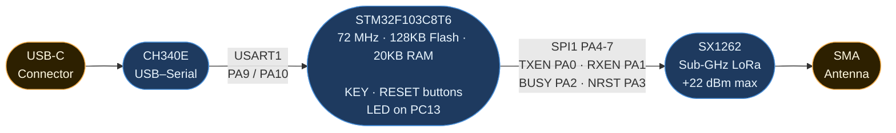

# Hardware Reference, DX-LR30

## Board Overview

The **DX-LR30** is a compact LoRa module combining an STM32F103C8T6
microcontroller with an SX1262 transceiver and a CH340E 10-pin USB-serial bridge.
It's being produced by Shenzhen DX-SMART Technology.
The official board docs: https://github.com/DX-SMART/LORAMODULE/

---

Physical board inspection revealed a serious mismatch with the provided schematic diagram: BOOT0 is not
connected to RTS of CH340E, DTR isn't connected too, which makes software DFU over USB impossible.
Additional findings:
- VBAT disconnected, it's an official path for battery metrics
- STM32F103xx chip has LQFP48 packaging (48 pins) 
- AMS1117-3.3 voltage regulator with 1.1V dropout
- The KEY button connected to PB12 which has no effect on entering the bootloader mode.

## Pin Assignments

### SPI1, SX1262 Interface

| GPIO | SX1262 Pin | Direction | Description |
|------|-----------|-----------|-------------|
| PA4  | NSS | → | Chip Select (active LOW) |
| PA5  | SCK | → | SPI Clock |
| PA6  | MISO | ← | Master In Slave Out |
| PA7  | MOSI | → | Master Out Slave In |
| PA2  | BUSY | ← | Radio busy flag |
| PA3  | NRST | → | Radio hard reset |
| PA0  | TXEN | → | RF switch, TX mode |
| PA1  | RXEN | → | RF switch, RX mode |
| PC15 | DIO1 | ← | RxDone flag (verified on HW by multimeter; shared net with LSE OSC32_OUT) |

### USART1, Serial Console (CH340)

| GPIO | CH340 Pin | Description |
|------|-----------|-------------|
| PA9 | RXD | Serial TX (115200 8N1) |
| PA10 | TXD | Serial RX |

> The `ENABLE_HWSERIAL1` build flag is **required** to map `Serial` to USART1.
> Without it, Arduino STM32 defaults `Serial` to USART2 and nothing appears
> on the USB port.

### Other

| GPIO | Function |
|------|----------|
| PB11 | blue LED |

### SWD Debug Header (headless flashing)

The board exposes a 4-pin SWD header, labeled **V G D C**:

| Pin | Net | MCU pin |
|-----|-----|---------|
| V | 3V3 | — |
| G | GND | — |
| D | SWDIO | PA13 |
| C | SWCLK | PA14 |

An ST-Link V2 on these 4 pins gives fully headless flashing
(`st-flash write firmware.bin 0x08000000`) with no bootloader entry at all —
see [flashing.md, Headless flashing: SWD](flashing.md#headless-flashing-swd-recommended).

### STM32F103 Bootloader Specs

| Parameter | Value |
|-----------|-------|
| UART | USART1 (PA9/PA10) |
| Baud | Auto-detect from 0x7F byte |
| Frame | 8E1 (even parity) |
| Chip ID | `0x0410` (STM32F10xxx Medium-density) |
| Bootloader version | `0x22` |
| Flash base | `0x08000000` |
| Max flash | 128KB  |

---

## Power

| Source | Voltage | Notes |
|--------|---------|-------|
| USB-C | 5V | Via CH340 onboard regulator → 3.3V |
| Min current | ~0.5 mA | Idle, radio in RX |
| Peak current | ~150 mA | During LoRa TX burst |
The board can be powered from a Li-ion battery, TODO: identify safe pins

---

## Unique Device ID

The STM32F103 has a factory-programmed 96-bit unique ID at `0x1FFFF7E8`.
